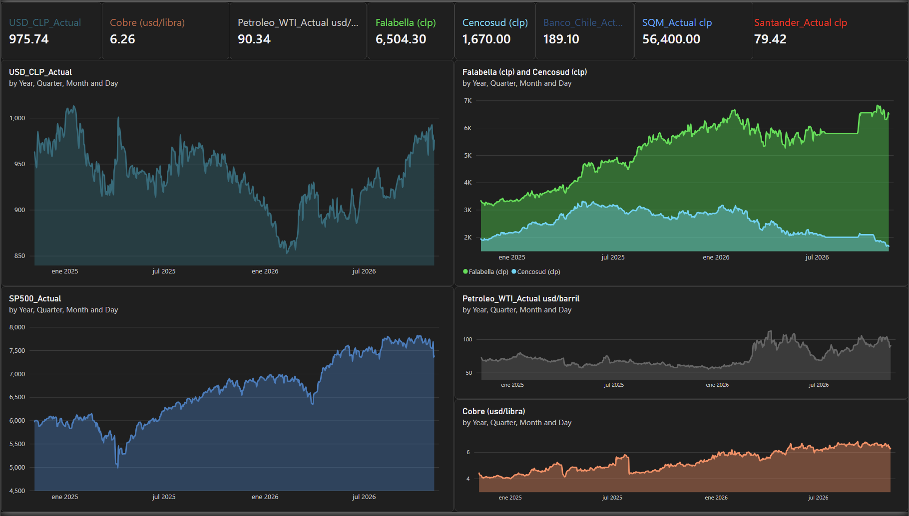

# Dashboard del Mercado Financiero Chileno y Benchmarks Globales

Dashboard interactivo en Power BI que compara acciones chilenas con el tipo de cambio, las materias primas y el mercado global. Lo alimenta un pipeline de datos automatizado en Python.



---

## ¿Qué problema resuelve?

Seguir el mercado chileno exige mirar varias cosas a la vez: el dólar, el cobre, el petróleo, Wall Street y las acciones locales. Este proyecto automatiza la descarga y el procesamiento de esos datos y los reúne en un solo tablero, para responder rápidamente:

- ¿Cómo se han movido las acciones chilenas frente al S&P 500?
- ¿Qué relación hay entre el cobre, el dólar y acciones como SQM?
- ¿Qué activos han sido más volátiles en el último año?

---

## Activos cubiertos

| Grupo | Activos |
|---|---|
| **Acciones chilenas (IPSA)** | Falabella, Cencosud, Banco de Chile, Banco Santander Chile, SQM-B |
| **Moneda y materias primas** | USD/CLP, cobre (futuros, USD/lb), petróleo WTI (USD/barril) |
| **Benchmarks globales** | S&P 500, iShares MSCI Mexico (EWW) como referencia latinoamericana |

---

## Cómo funciona

```
Yahoo Finance  →  Python (ETL)  →  CSV / Excel  →  Power BI (modelo + DAX)  →  Dashboard
```

### 1. Pipeline ETL en Python

El script descarga dos años de precios diarios con `yfinance` y genera:

| Archivo | Contenido |
|---|---|
| `precios_historicos_mercado.csv` | Precios de cierre diarios de todos los activos |
| `retornos_diarios_mercado.csv` | Retornos diarios |
| `Dashboard_Mercado_Tiempo_Real.xlsx` | Tres hojas: resumen ejecutivo, precios históricos y matriz de correlación |

El **resumen ejecutivo** calcula para cada activo el precio actual, la variación diaria, mensual y anual, y la volatilidad anualizada. La **matriz de correlación** mide qué activos se mueven juntos.

### 2. Dashboard en Power BI

- **Tarjetas KPI** con el último precio de cada activo.
- **Gráficos de evolución** del dólar, el S&P 500, el petróleo, el cobre y las acciones de retail.
- **Medidas DAX** como `LASTNONBLANKVALUE` para mostrar el último precio de cierre disponible, aunque el día no haya sido hábil.
- Navegación por año, trimestre, mes y día.

---

## Principales observaciones (oct 2024 – oct 2026)

Calculadas con los datos generados por el pipeline:

- **Bancos chilenos, los grandes ganadores:** Banco de Chile (+97%) y Santander Chile (+94%) casi duplicaron su precio, superando ampliamente al S&P 500 (+34%). Ambos tienen una correlación diaria de 0,63: se mueven como sector.
- **Retail con trayectorias opuestas:** Falabella subió +102%, mientras Cencosud terminó solo +6%, tras caer 43% desde su máximo de mayo de 2025.
- **SQM, el activo más volátil:** pasó de un mínimo de ~28.000 CLP (junio 2025) a un máximo de ~84.800 CLP (mayo 2026). Su correlación con el cobre es baja (0,22), lo que confirma que su precio responde más al litio que al cobre.
- **Materias primas:** el cobre subió +43% hasta máximos cercanos a 6,8 USD/lb, y el petróleo WTI osciló entre 55 y 113 USD/barril.
- **Dólar:** el USD/CLP tocó un máximo de ~1.013 (enero 2025), un mínimo de ~852 (febrero 2026) y cerró el período en ~984.

---

## Tecnologías

- **Python:** pandas, NumPy, yfinance, openpyxl
- **Power BI Desktop:** modelo de datos y DAX
- **Git y GitHub**

---

## Ejecución local

```bash
git clone https://github.com/camilojosemorales2002/miproyecto-mercado-chile.git
cd miproyecto-mercado-chile
pip install -r requirements.txt
python scripts/01script_mercado.py
```

Después abre `powerbi/dashboard_mercado_chile.pbix` en Power BI Desktop y haz clic en **Actualizar** para cargar los datos nuevos.

---

## Estructura

```
├── scripts/
│   └── 01script_mercado.py    # Pipeline ETL
├── data/                      # CSV y Excel generados
├── powerbi/
│   ├── dashboard_mercado_chile.pbix
│   └── screenshots/           # Capturas del dashboard
├── requirements.txt
└── README.md
```

---

## Autor

**Camilo José Morales Carvajal**
Licenciado en Ciencias de la Administración, Universidad Adolfo Ibáñez · Magíster en Estrategia y Gestión (en curso)

[LinkedIn](https://www.linkedin.com/in/camilojos%C3%A9morales/) · [GitHub](https://github.com/camilojosemorales2002) · Otro proyecto: [Terminal de Equity Research](https://asset-management-tool-povmphoq23xobuy6xvgwac.streamlit.app/)
